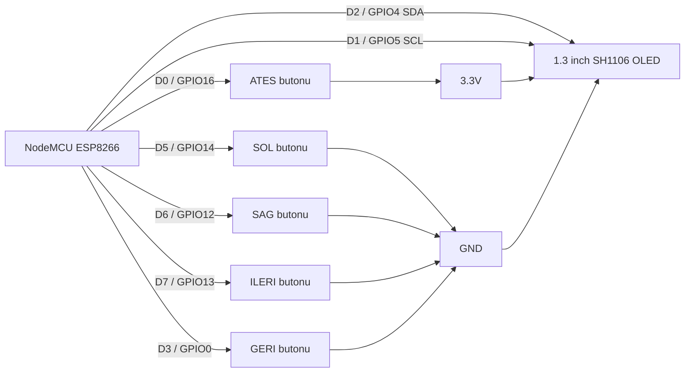

# ESP8266 OLED DOOM Controller

ESP8266 NodeMCU ve 1.3" 128×64 SH1106 OLED üzerinde çalışan, Doom esintili küçük bir raycasting FPS demosu.

Bu repo iki kontrol yöntemini **aynı anda** destekler:

- Telefonda açılan düşük gecikmeli WebSocket kumandası
- 5 fiziksel buton

> Bu proje orijinal DOOM motorunu, WAD dosyalarını veya telifli DOOM görsellerini içermez. Oyun, mikrodenetleyici için yazılmış bağımsız bir "Doom-like" raycasting demosudur.

## Özellikler

- ESP8266 NodeMCU
- 1.3" SH1106 128×64 I²C OLED
- 3D raycasting görüntü
- Duvar çarpışması
- 4 düşman
- Ateş etme ve can sistemi
- HUD
- Wi-Fi Access Point
- WebSocket tabanlı düşük gecikmeli telefon kontrolü
- 5 fiziksel buton
- Telefon + fiziksel butonlar aynı anda kullanılabilir
- İnternet veya modem gerekmez

## Gerekli parçalar

| Parça | Adet |
|---|---:|
| NodeMCU ESP8266 | 1 |
| 1.3" SH1106 128×64 I²C OLED | 1 |
| Anlık basmalı buton | 5 |
| Breadboard | 1 |
| Jumper kablo | Yeteri kadar |
| USB veri kablosu | 1 |

## OLED bağlantısı

| SH1106 OLED | NodeMCU ESP8266 |
|---|---|
| VCC | 3.3V |
| GND | GND |
| SDA | D2 / GPIO4 |
| SCL | D1 / GPIO5 |

## Fiziksel buton bağlantıları

| İşlev | ESP8266 pini | Butonun diğer ucu |
|---|---|---|
| SOL | D5 / GPIO14 | GND |
| SAĞ | D6 / GPIO12 | GND |
| İLERİ | D7 / GPIO13 | GND |
| GERİ | D3 / GPIO0 | GND |
| ATEŞ | D0 / GPIO16 | 3.3V |

### Önemli

`GERİ` butonu D3 / GPIO0 pinindedir. ESP8266 açılırken veya resetlenirken bu butona basılı tutma. GPIO0 açılış sırasında LOW olursa kart programlama modunda kalabilir.

`ATEŞ` butonu farklı bağlanır. D0 / GPIO16, `INPUT_PULLDOWN_16` kullanır. Bu nedenle ateş butonu **D0 ile 3.3V arasına** bağlanır.

## Bağlantı şeması



Daha ayrıntılı yapım için [`docs/WIRING_TR.md`](docs/WIRING_TR.md) dosyasına bak.

## Arduino IDE kurulumu

### 1. ESP8266 kart paketini ekle

Arduino IDE:

`Dosya > Tercihler > Ek Kart Yöneticisi URL'leri`

Şunu ekle:

```text
https://arduino.esp8266.com/stable/package_esp8266com_index.json
```

Sonra:

`Araçlar > Kart > Kart Yöneticisi`

`esp8266` ara ve **esp8266 by ESP8266 Community** paketini kur.

### 2. Kütüphaneleri kur

Arduino IDE > Kütüphane Yöneticisi:

1. `Adafruit GFX Library`
2. `Adafruit SH110X`
3. `WebSockets` — Markus Sattler / Links2004

### 3. Kartı seç

```text
Araçlar
> Kart
> esp8266
> NodeMCU 1.0 (ESP-12E Module)
```

Önerilen ayarlar:

```text
CPU Frequency: 160 MHz
Flash Size: 4MB
Upload Speed: 115200
```

### 4. Kodu aç

`ESP8266_OLED_DOOM/ESP8266_OLED_DOOM.ino`

dosyasını Arduino IDE ile aç.

### 5. ESP8266'ya yükle

Doğru COM portunu seç ve `Yükle` butonuna bas.

## Telefonla kontrol

Kart açılınca kendi Wi-Fi ağını oluşturur:

```text
Wi-Fi: DOOM-ESP8266
Şifre: doom1234
```

Telefonda bu ağa bağlan.

Telefon "Bu ağda internet yok" uyarısı verirse **bağlı kal**.

Tarayıcıya:

```text
http://192.168.4.1
```

yaz.

Beş kontrol çıkar:

- İleri
- Geri
- Sol
- Sağ
- FIRE

Birden fazla tuşa aynı anda basılabilir.

Örneğin:

- İleri + sağ
- İleri + ateş
- İleri + sağ + ateş

Kontrol HTTP polling yerine WebSocket ile yapılır. Bu nedenle önceki `fetch()` tabanlı sürüme göre daha düşük gecikmelidir.

## Neden kontrol takılı kalmıyor?

Telefon her 100 ms'de mevcut tuş durumunu WebSocket üzerinden yeniler.

ESP8266 yaklaşık 350 ms boyunca yeni durum alamazsa telefon girdisini otomatik olarak sıfırlar.

Wi-Fi koparsa karakterin sürekli ileri yürümesi engellenir.

## Proje klasör yapısı

```text
esp8266-oled-doom-controller/
├── ESP8266_OLED_DOOM/
│   ├── ESP8266_OLED_DOOM.ino
│   ├── config.h
│   └── web_ui.h
├── docs/
│   ├── BUILD_GUIDE_TR.md
│   ├── WIRING_TR.md
│   └── TROUBLESHOOTING_TR.md
├── .gitignore
├── LICENSE
├── platformio.ini
└── README.md
```

## PlatformIO

İstersen Arduino IDE yerine PlatformIO da kullanabilirsin.

Repo kökündeki `platformio.ini` gerekli bağımlılıkları içerir.

## Sorun giderme

Ekran açılmıyorsa, bağlantılar doğruysa ve OLED SH1106 ise ilk olarak `config.h` içindeki:

```cpp
#define OLED_ADDR 0x3C
```

değerini kontrol et. Bazı ekranlar `0x3D` kullanabilir.

Detaylı hata çözümleri için:

[`docs/TROUBLESHOOTING_TR.md`](docs/TROUBLESHOOTING_TR.md)

## Lisans

MIT License.

DOOM adı ve ilgili ticari markalar sahiplerine aittir. Bu repo ticari DOOM varlıklarını içermez.
